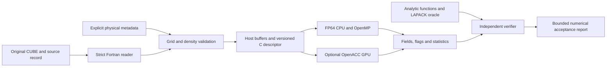
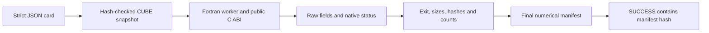

# Architecture and implementation boundaries

The reader, CPU field evaluator and independent oracle passed combined synthetic
checks and were merged with user approval; see [acceptance status](status.md).
The offline CLI and native adapter pass combined synthetic checks under the
[versioned integration protocol](cli-contract.md) and are merged. CPU X-slab
support follows the [M2 contract](slab-contract.md) and passes combined synthetic
checks and is merged. The optional [M3B1 public GPU backend](openacc-public-results.md)
and [M3B2 offline GPU CLI](openacc-cli-results.md) now pass finite synthetic
validation. The first [stored-water real-density case](water-validation.md)
has conditional scientific acceptance; performance remains NOT_RUN.

## Ownership and dependency direction

- `src/io` owns stream parsing and explicit metadata checks. It preserves raw
  density values, exposes a Fortran grid type, and makes no provenance or
  scientific-certification claim.
- `include/nci_api.h` owns the portable field-evaluation interface. Its caller
  allocates host buffers and supplies capacities, dense layout, periodic axes
  and a row-major inverse step matrix. No compiler-specific descriptors cross
  this boundary.
- `src/backend_cpu` owns fourth-order derivatives, Cartesian transforms,
  symmetric eigenvalues and output masks. It must neither infer input physics
  nor alter the input density.
- `src/backend_openacc` owns explicit device resources and synchronous GPU
  execution of the existing point evaluator. The optional library retains the
  same C ABI and numerical specification; the CPU build needs no NVIDIA SDK.
- `reference` and `tests/oracle` own independent expectations. They may read the
  public header but must not import production routines to generate truth.
- `cli/nci_cli.py` owns strict JSON execution cards, immutable input snapshots,
  source hashes, child-process timeout and final receipts. It uses the Python
  standard library; it does not parse density values or implement derivatives.
- `src/driver` owns the Fortran reader-to-C-ABI bridge. It reads a small internal
  namelist, reserves storage before reading the grid, transfers metadata and
  geometry explicitly, and writes raw arrays and a native status record.
  No LLM, network service or model credential is a runtime dependency.

The reader type and C descriptor are separate interfaces. The native
adapter must explicitly transfer Z-fastest storage, inverse/transpose conventions
and metadata; the existence of both libraries alone is not pipeline integration.
The [adapter contract](adapter-contract.md) defines the tested M1 connection.

## Offline execution and receipt

The CLI exclusively creates a new output directory. The worker's tracked
arrays are covered by a checked allocation budget before the reader allocates
density. This accounting includes output fields, diagnostics, atom data, CPU
neighbor tables and an explicit allowance; it is not a whole-process RSS cap.
The merged M2 scheduler supports full-grid or sequential X-slab execution.
It keeps the complete density and buffers one slab's halo and output fields,
then appends fields in global order. It does not provide out-of-core input.
The actual origin and axis vectors must equal the declared binary64 geometry.
The worker retains all flags and invalid-point NaNs. Python checks the closed
files without loading all field arrays, then writes the success marker last.
Failed or interrupted outputs remain inspectable and cannot be mistaken for
an accepted scientific result. An accepted numerical run still has unknown
scientific uncertainty.

## Numerical boundary

The discrete operator acts on integer grid coordinates. The step matrix J has
the three physical steps as columns. Transform with `J^-T gq` and
`J^-T Hq J^-1` exactly once. Compute the middle **algebraically sorted**
eigenvalue of the Cartesian Hessian. Input thresholds do not clip neighboring
density values before differentiation.

Invalid input-derived points have NaN fields and explicit bits. Numerically
valid points retain raw values even when a sign is uncertain. Scientific
uncertainty remains set until independent input-precision and grid-convergence
information exists. See [numerics](numerics.md) and [ABI](abi.md).

## Build and release boundary

GNU and NVIDIA Fortran always use separate module/build directories. CPU
configuration works without the NVIDIA SDK. The unchanged ABI supports complete
dense grids and canonical X slabs with complete Y/Z in the merged M2 backend.
Other partial layouts remain unsupported. Global periodic wrapping and
mixed-derivative corner halos are covered by independent finite fixtures.

Independent worktrees can be compiled together through root CMake source-path
options. That is a validation operation, not a Git merge or release. Small
synthetic tests establish only their stated engineering/numerical properties.
Real-density studies and benchmarks use a finite execution package managed by
a GPT-6.1 Sol subagent under the [standing authorization](development.md), with
its own inputs, limits, hashes, exit status and acceptance record.
