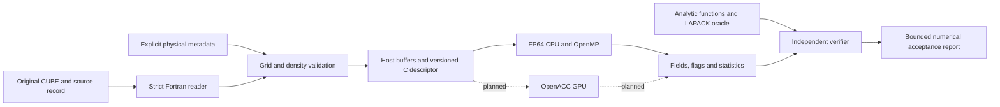

# Architecture and implementation boundaries

This is the target data flow. The reader and independent oracle are implemented
in separate draft PRs; CPU field evaluation is under development. A complete
end-to-end command-line application and GPU NCI backend are not yet available.

## Ownership and dependency direction

- `src/io` owns stream parsing and explicit metadata checks. It preserves raw
  density values, exposes a Fortran grid type, and makes no provenance or
  scientific-certification claim.
- `include/nci_api.h` owns the portable field-evaluation interface. Its caller
  allocates host buffers and supplies capacities, dense layout, periodic axes
  and a row-major inverse step matrix. No compiler-specific descriptors cross
  this boundary.
- `src/backend_cpu` owns fourth-order derivatives, Cartesian transforms,
  symmetric eigenvalues and output masks. It must neither infer input physics
  nor alter the input density.
- `reference` and `tests/oracle` own independent expectations. They may read the
  public header but must not import production routines to generate truth.
- Later CLI/cache/scheduler modules will connect these components and manage
  frozen execution cards. No LLM, network service or model credential is a
  runtime dependency of the scientific program.

The current reader type and C descriptor are separate interfaces. A future
adapter must explicitly transfer Z-fastest storage, invert/transpose conventions
and metadata; the existence of both libraries alone is not pipeline integration.

## Numerical boundary

The discrete operator acts on integer grid coordinates. The step matrix J has
the three physical steps as columns. Transform with `J^-T gq` and
`J^-T Hq J^-1` exactly once. Compute the middle **algebraically sorted**
eigenvalue of the Cartesian Hessian. Input thresholds do not clip neighboring
density values before differentiation.

Invalid input-derived points have NaN fields and explicit bits. Numerically
valid points retain raw values even when a sign is uncertain. Scientific
uncertainty remains set until independent input-precision and grid-convergence
information exists. See [numerics](numerics.md) and [ABI](abi.md).

## Build and release boundary

GNU and NVIDIA Fortran always use separate module/build directories. CPU
configuration works without the NVIDIA SDK. The initial ABI accepts complete
dense grids and explicitly rejects partial tiles; later slab support must retain
global periodic wrapping and mixed-derivative corner halos.

Independent worktrees can be compiled together through root CMake source-path
options. That is a validation operation, not a Git merge or release. Small
synthetic tests establish only their stated engineering/numerical properties.
Real-density studies and benchmarks use a later finite manual execution package
with its own inputs, limits, hashes, exit status and acceptance record.
